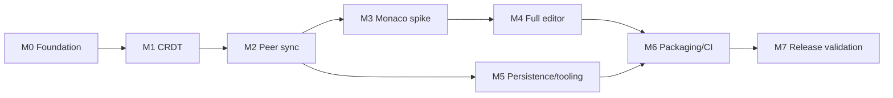

# c2g — Code 2gether Incremental Implementation Plan

**Status:** M0 complete; later milestones remain proposals and require approval.
**Basis:** the preserved P2PDocs 2.0 research and change-request records in
`docs/MODERNIZATION_RESEARCH.md` and `docs/CHANGE_REQUEST.md`. c2g is derived
from P2PDocs; historical source/archive references in those records are retained
for attribution and evidence.
**Operating principle:** One milestone, one small vertical slice and one evidence-based gate at a time; avoid broad refactors.

## Operating protocol for every Codex session

1. Read `AGENTS.md` and `CONTEXT.md`, then this plan and the current milestone's CR IDs.
2. Query a current Graphify graph first when available, then examine relevant source and tests; do not assume the graph is installed or accurate.
3. Report the next milestone's bounded files and test scope **before** changes. Preserve CLI, no central server, offline operation, and existing useful UI until replacement is proven.
4. Add a failing regression test for each bug before making its correction (where feasible). Use targeted tests first, then full affected suite.
5. Keep source changes confined to approved milestone; don't add frameworks/packages without objective evidence.
6. Record commands/results as observed; never claim tests passed if not run. Update `CONTEXT.md` with `DONE / BLOCKED`, decisions, changed files, test results, next precise action. After code changes update Graphify only when installed.
7. Stop after the milestone, do not roll into the next milestone automatically.

## Milestone dependency map

**Practical ordering adjustment:** M3 (small Monaco/webview feasibility experiment only) may run after M0 and in parallel with M1 **without merging an editor rewrite** to detect renderer blockers early. But full UI (M4) must wait until M1/M2 pass their gates. M5 persistence state-format decisions should be settled alongside M1's model design even if implemented later.

## M0 — Baseline and agent-ready development foundation

**Complexity:** Low–Medium. **Completed:** 2026-10-23. **Gate:** G0 PASS.
**Objective:** Create reproducible test harness and orient future Codex tasks before behavior changes.

**Expected changes:** `tests/test_crdt_regressions.py` (new, expected initially red), `tests/conftest.py`, `pyproject.toml` test tooling if approved, `AGENTS.md`, `CONTEXT.md`, `.gitignore`, potentially `.codex/skills/graphify/*` **only by Graphify's supported installer**, `docs/`.

**Tasks:**

1. Confirm Python interpreter, target OS, files/branch, current install method and `graphify --version` on developer machine. Do not assume local Graphify state from the ZIP.
2. Configure testable core imports without creating Tk windows. Avoid needless eager import and temporary disk persistence in tests; use `tmp_path` or injected in-memory persistence where feasible.
3. Capture *characterization tests* for `AB` + middle `X`, prepend `X`, full-state-then-delete, delete-before-insert, tombstone descendant, and canonical text. Initially expected failures are evidence, not successful behavior.
4. Agree on Python baseline, versioned protocol/state decisions and document ID policy **without implementing** them in M0.
5. Establish one command for unit tests (`python -m pytest -q` suggested) and CI skeleton; record failures clearly.
6. Configure Graphify project skill if present/approved; ensure installer-controlled sections preserved. No cloud credentials needed for local AST graph.

**Acceptance:** Source remains behaviorally unchanged (except strictly necessary testability improvements approved); each of 4+ historical defects has a reproducing test or clearly documented static proof; test command works and emits interpretable results; `CONTEXT.md` records baseline. **Done:** G0 recorded with exact versions and observations.

## M1 — CRDT convergence, causal handling and state correctness

**Complexity:** High. **Completed:** 2026-10-23. **Gate:** G1 PASS.
**Expected changes:** `c2g/crdt/document.py`, `types.py`, possibly `message.py`, core-only tests in `tests/test_crdt_*.py`; model-state format planning; avoid UI work.

**Tasks:**

1. Specify invariant and test harness: stable unique IDs; stable precedence links; visible linearization of tombstoned structure; deletion monotonicity; pending unseen operations; merge idempotence/commutativity and convergence after quiescent delivery.
2. Implement deterministic RGA insertion ordering that honors visual gaps; preserve tombstone nodes in the structural traversal; do not simply sort visible elements independently.
3. Preserve delete-before-insert as pending tombstone; preserve insert-before-parent as causal pending; validate no cycles/duplicate conflicting IDs.
4. Separate insert identity from deletion deduplication; join visibility using false-dominates-true; don't treat every full-snapshot character as a completed delete.
5. Normalize snapshot reconciliation and Lamport clock restoration; prevent ID collisions across resume.
6. Add loop/stack/performance guard for deep text or use iterative traversal; bound accepted inputs and state size.
7. Run deterministic 2–3 replica random histories with varied delivery permutations, duplicates and stale snapshots; log seeds of failures. Include Unicode/newlines.
8. If repeated adversarial tests expose fundamental complexity beyond the small engine, report a **GO/NO-GO** and propose `pycrdt` fallback, including protocol/migration cost, rather than silently switching.

**Acceptance:** All historical regression tests pass; replicated text and normalized state agree after eventual delivery and full merges; no tombstone resurrection; duplicate/reordered events harmless under documented causal buffering; seeded property tests pass over a documented trial count (propose at least 100 deterministic seeds × 3 replicas for first gate; adjust explicitly for speed). **Done:** test logs plus design rationale and protocol-version impact recorded.

## M2 — Reliable peer connectivity and state exchange

**Complexity:** High. **Depends:** M1. **Gate:** G2.
**Expected changes:** `c2g/network/manager.py`, `discovery.py`, `crdt/message.py`, bounded UI connector changes in `ui/editor.py` while Tk still used; new `network/session.py` only if needed; socket tests.

**Tasks:**

1. Add typed/framed HELLO with peer ID, listen address/port, doc ID, protocol version and capability rejection; support nondefault listen ports for same-host tests.
2. Trigger targeted reconciliation on successful join and reconnect (including all tombstones), not opportunistic periodic/failed-delete sync.
3. Track origin and stable operation IDs; forward remote ops to other relevant peers once and only once, without loops; make request/response targeted.
4. Establish explicit document-join UX: joining remote document versus merging your separate local document; reject mismatched doc IDs with user-visible reason.
5. Validate incoming messages/framing lengths and fields, bounded pending buffers, timeouts and clean per-peer teardown. Keep GUI callbacks on its owning thread.
6. Keep UDP broadcast discovery but provide explicit click-to-connect using advertised port; test stale/duplicate peers. Do not infer automatic connection from discovery.
7. Add two-peer, A↔B↔C, disconnect/rejoin, fragmentation/coalescing and invalid-frame tests with temporary distinct ports.

**Acceptance:** New peer sees an existing document; all 3 peers converge after A modifies while C is disconnected then C rejoins; malformed peer cannot kill app; every operation forwarded once (for chosen topology); old protocol rejection is deterministic and documented; manual IP works. **Status (2026-10-23): PARTIAL.** Automated protocol/session/sync/relay/discovery evidence is implemented (30 total tests); manual two-instance Tk plus physical-LAN discovery smoke remains required before G2 can pass. See `M2_NETWORK_RELIABILITY_REPORT.md`.

## M3 — Monaco + pywebview feasibility spike (throwaway or isolated branch)

**Complexity:** Medium–High. **Depends:** M0; preferably M1/M2 stabilized before integration. **Gate:** G3.
**Expected changes:** isolated `web/` Vite+Monaco prototype, `c2g/ui/bridge_spike.py` or separate `spikes/` directory; no replacement of Tk UI yet.

**Tasks:**

1. Verify supported Python and native pywebview renderer versions: Windows WebView2; Linux GTK/WebKit2 or Qt WebEngine. Note platform prerequisite installation (only with permission).
2. Initialize pinned ESM `monaco-editor` using Vite, local build outputs and locally served workers (no `file://` worker assumption or external CDN).
3. Bridge Monaco change batch → Python logical transaction → incremental Monaco patch; test origin guard, model versions and serialized dispatcher.
4. Probe Unicode UTF-16 vs code-point offset conversion; emoji, accent marks, multiline, IME and pasted 10k characters; no full `setValue` on remote edits.
5. Validate viewport, minimap, line numbers, keyboard shortcuts, search, clipboard, accessibility basics and undo/redo semantics after remote edits.
6. Test offline and frozen resource resolution assumptions; record startup timings and artifact footprint as measurements **only when run**.
7. If pywebview fails support/worker/renderer gate, try Qt WebEngine with the exact same Python bridge interface; provide evidence and choose one.

**Acceptance:** Runs without internet on both intended desktop platforms; all workers initialize; 10k paste and remote insert/delete keep editor/model equivalent; no feedback loops, cursor/selection stable; undo behavior explicitly scoped; choose A or B with measured tradeoffs. **Done:** G3 records browser/OS/renderer versions and exit decision.

## M4 — Production editor integration and familiar desktop UX

**Complexity:** High. **Depends:** M1, M2, M3. **Gate:** G4.
**Expected changes:** `c2g/ui/editor.py` replaced or retained as compatibility shim; new UI host/bridge/adapter modules; `web/src/*`, compiled assets packaging strategy; cross-boundary tests.

**Tasks:**

1. Move all local text modifications to a single event bridge; eliminate per-key Tk delayed callbacks and full rebuild loops.
2. Apply multi-edit local transactions in correct order; render remotely via small patches with source-origin suppression and document version reconciliation.
3. Implement VS Code-like dark presentation for one document: Monaco main editor, minimal title/peer list/connect, status bar, Save export, optional minimap toggle.
4. Preserve `c2g username [peer_ip]` and manual connect workflow with improved peer names/states.
5. Implement defined undo/redo behavior (or gate/disable until collaborative semantics pass); verify selections, paste, mouse edits, multi-cursor and Unicode.
6. Keep all JS/CSS/worker assets local and maintain the offline test; never run a remotely reachable UI HTTP server.

**Acceptance:** Real native c2g window with working Monaco on Windows/Linux; 2/3-peer editing feature parity; all UI-01..07 and associated NET tests pass; no hidden TODO preventing declared features. **Done:** G4 screenshot/manual checklist plus bridge test logs.

## M5 — Safe persistence + Python metadata hygiene

**Complexity:** Medium. **Depends:** core state schema M1; UI join identity M2; may be developed ahead of M4 if valuable. **Gate:** G5.
**Expected changes:** `c2g/storage/persistence.py`, CRDT load/save boundaries, CLI/config, `pyproject.toml`, `setup.py`, tests and user docs.

**Tasks:**

1. Replace destructive `start_fresh=True` default with explicit New/Resume behavior and per-document stable storage keys.
2. Specify versioned structured serialized state for elements, tombstones, clocks and pending ops; immutable queue snapshots, one writer thread, atomic temp + flush + replace, clean shutdown join.
3. Corrupt-state recovery and backups; **do not auto-`pickle.load`**. Decide trusted one-time legacy migration with original backup, or document manual export only.
4. Choose Python 3.12+ unless M3 platform test rules otherwise; make `[project]` metadata canonical, correct SPDX license, author/source consistency, remove unused SCM build dependency.
5. Add lockfiles/dev tooling; make headless core import feasible and treat platform-specific webview packages appropriately.
6. Validate installation and restart/resume on clean temp user profiles; test simultaneous local documents do not overwrite each other.

**Acceptance:** Persistent state survives controlled restart and interrupted write test; no silent overwrite or deserialization of arbitrary pickle; metadata builds; old CLI usage still works; G5 records format version and migration policy. **Done:** tests plus documented developer start commands.

## M6 — Release tooling and headless peer simulation

**Complexity:** Medium. **Depends:** M4 + M5. **Gate:** pre-G6.
**Expected changes:** CI workflows, release/build scripts/spec files, `Dockerfile.tests`, `compose.test.yml` (optional), `.gitignore`, documentation, app icon assets if available.

**Tasks:**

1. Build Vite frontend assets with pinned versions offline at runtime; PyInstaller **onedir** Python GUI binary with bundled web assets/worker scripts per OS.
2. Document Windows WebView2 and Linux GTK/Qt runtime prerequisites; test artifact resource paths and renderer load.
3. Define small Docker headless peer-test image; assign distinct ports and avoid using Docker LAN broadcast as a discovery correctness test.
4. CI gates: Python unit/property/socket tests, JS tests/build, Windows/Linux binary builds, artifact smoke checks where runner supports desktop UI; release only after green gates.
5. Preserve PyPI packaging if needed but separate native release artifact pipeline; use trusted publishing with permissions and protection.
6. Document generated artifact sizes and startup times from real measurements; don't claim universal portability.

**Acceptance:** Reproducible two-platform artifact builds, headless Docker tests passing on supported environment, consistent release version metadata, no unbundled CDN dependency. **Done:** executable checksums, CI logs and platform limitations recorded.

## M7 — End-to-end validation and release decision

**Complexity:** Medium. **Depends:** M6. **Gate:** G6 release.
**Expected changes:** bug fixes strictly tied to failed verification, release docs and troubleshooting, `CONTEXT.md`, README accurate limitations; no unrelated new features.

**Tasks:**

1. Execute scripted/manual 2-peer and 3-peer Windows/Linux tests (typing, middle insert, paste, undo if enabled, Delete, reconnect and full sync) on clean installations.
2. Run randomized convergence tests at agreed seed count and bounded document stress; record versions/times and failures.
3. Run cold startup, offline Monaco worker, file-export, document resume/corruption scenarios and port conflict cases.
4. Check incoming frame fuzz, resource caps, no accidental non-loopback UI asset listener, and trusted-LAN warnings.
5. Publish an evidence-based support matrix and migration/protocol-change notes. Label unfinished noncritical items honestly.

**Acceptance:** All required `OUT-*` and must-have CRs pass; no remaining P0 CRDT/network defect; runnable native artifacts and honest release documentation. **Done:** G6 signed-off by project owner; no automatic release before signoff.

## Milestone status tracker (research snapshot)

| Milestone | Status | Last completed evidence | Next step |
|---|---|---|---|
| M0 | COMPLETE — G0 PASS | Six passing characterization tests; six strict expected failures; restored and aligned planning records | Await explicit authorization for M1 |
| M1 | COMPLETE — G1 PASS | 22 passing CRDT tests, including 100 deterministic three-replica histories | Await explicit authorization for M2 |
| M2 | NOT STARTED | Identified NET-F1..F10 | Wait for M1/G1 |
| M3 | NOT STARTED | Official Monaco/pywebview API docs reviewed | Confirm supported OS targets before spike |
| M4 | NOT STARTED | Proposed JS/Python contract | Wait for M1–M3 |
| M5 | NOT STARTED | Unsafe pickle/start_fresh findings | Wait for model schema decision |
| M6 | NOT STARTED | Native builds/Docker options researched | Wait for M4/M5 |
| M7 | NOT STARTED | Gates/criteria defined | Wait for M6 |

## Next precise Codex task after explicit approval

> **Do not begin M2 without explicit approval.** M1 is complete. The next approved
> task must be bounded to M2 and begin by reviewing the G1 evidence, these plans,
> Graphify, and the network/CRDT boundary. Do not migrate the UI, install frontend
> dependencies, or make M3+ changes as part of that work.
