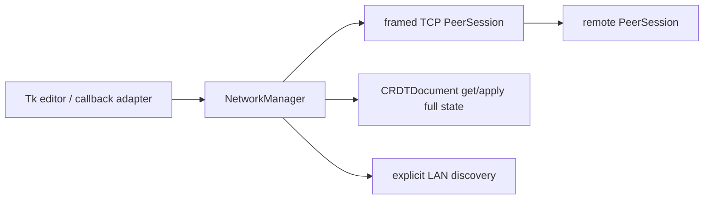

# M2 Network Reliability Report

## Executive summary

M2 introduces protocol version 2 TCP sessions: all traffic, including HELLO, is
four-byte big-endian length framed JSON. `NetworkManager` owns no Tk objects;
the editor uses callbacks and schedules widget work with `after`.

## Architecture



## Protocol and lifecycle

`PROTOCOL_VERSION = 2`; required capabilities are `rga-before-anchor`,
`pending-tombstones`, and `state-sync`. HELLO carries an asserted stable
process peer UUID, display username, document UUID, actual bound listening
port, version, capabilities, and explicit empty-document join intent. These
identities are distinct from CRDT client IDs and a TCP connection.

Handshake is send-HELLO/read-HELLO. Unsupported versions, missing capabilities,
invalid metadata, self/duplicate sessions, and document mismatches receive a
`REJECT` where possible and close. An outgoing, explicitly empty document may
adopt the remote document ID; a nonempty unrelated document is rejected.
READY means each side has emitted its full CRDT state snapshot on the ordered
TCP stream. Operations generated during `SYNCING` enter a bounded (1,000
packet) per-session buffer and are written immediately after the snapshot under
the same send lock, so later operations cannot overtake that snapshot.
Snapshots use `get_full_state`/`apply_full_state`, so elements, before anchors,
tombstones, and pending delete markers are retained.

Application operations use a stable envelope message ID while relayed. A
bounded 20,000-entry LRU-style seen set suppresses duplicate processing and
forwarding; relay excludes the source peer. Snapshot/control traffic remains
connection-local. The receive decoder handles fragmented/coalesced frames,
invalid UTF-8/JSON, invalid lengths, and a 12 MiB maximum frame/buffer limit.
Inbound handshakes are timeout-bound and capped at 16 workers; sessions are
capped at 16. No global peer lock is held while writing or closing sockets.

## Verified former defects

- Raw username handshake and port-derived identity: replaced by framed HELLO
  and asserted peer UUID/listening port.
- No connection-time state exchange: reciprocal full-state snapshots are sent.
- No relay/duplicate control: operation envelopes relay with source exclusion
  and bounded de-duplication.
- Broadcast sync response: full sync is session-targeted.
- Rejoin loss: reconnect repeats bidirectional CRDT reconciliation.
- Discovery timestamp trust: announcements include protocol/peer/actual port
  and expire using local monotonic receipt time.

## Tests

```text
./.venv/bin/python -m pytest -q tests/test_network_m2.py  # 8 passed
./.venv/bin/python -m pytest -q                            # 30 passed
./.venv/bin/python -c "import c2g"                         # passed
git diff --check                                           # passed
```

The socket tests use ephemeral loopback ports and cover fragmentation/coalescing,
legacy HELLO rejection, partial-frame disconnect, initial join, wrong-document
rejection, reconnect after independent offline edits, a three-peer chain, a
three-peer cycle with duplicate logical delivery, simultaneous cross-connect,
live edit during a deliberately paused snapshot boundary, repeated listener
shutdown, and discovery validation/expiry. The networking test module was run
twice consecutively (8 passed each run). No GUI/LAN broadcast manual smoke test
was performed.

Discovery announces protocol/version, peer ID, username and actual TCP port.
It validates datagrams using a deterministic `process_announcement` seam and
expires them from local monotonic receipt time. The Tk adapter transfers
network/discovery events through a `queue.Queue`, drained by `root.after`; it
lists discovered peers separately with endpoints and an explicit Connect button.
Discovery never auto-connects.

## Security and compatibility

This is not encrypted or authenticated and is intended only for a controlled,
trusted LAN. Legacy unframed P2PDocs peers cannot complete protocol-v2 HELLO
and are rejected. No NAT traversal, cloud service, or persistent identity was
added.

## Changed files

- `c2g/network/manager.py`, `c2g/network/discovery.py`
- `c2g/crdt/message.py`, `c2g/ui/editor.py`, `c2g/cli.py`
- `tests/test_network_m2.py`

## Remaining limitations and Gate G2

**G2: PARTIAL.** Automated M2 requirements are covered by focused loopback and
headless tests and the UI adapter is implemented. The remaining gate blocker is
the required practical GUI/LAN smoke test: this environment did not launch two
Tk applications, verify broadcast discovery on a physical LAN, or visually
confirm status/explicit-connect behavior. The protocol remains trusted-LAN
only: it provides neither authentication nor encryption.
