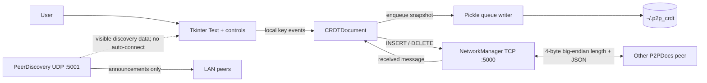
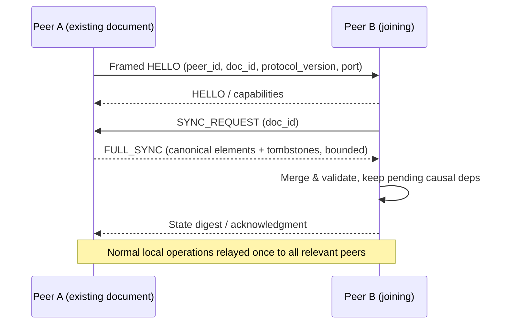
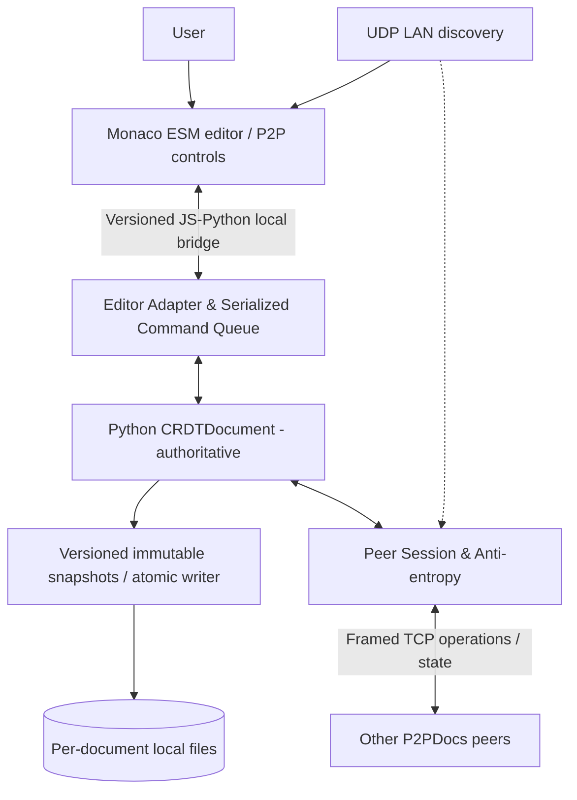
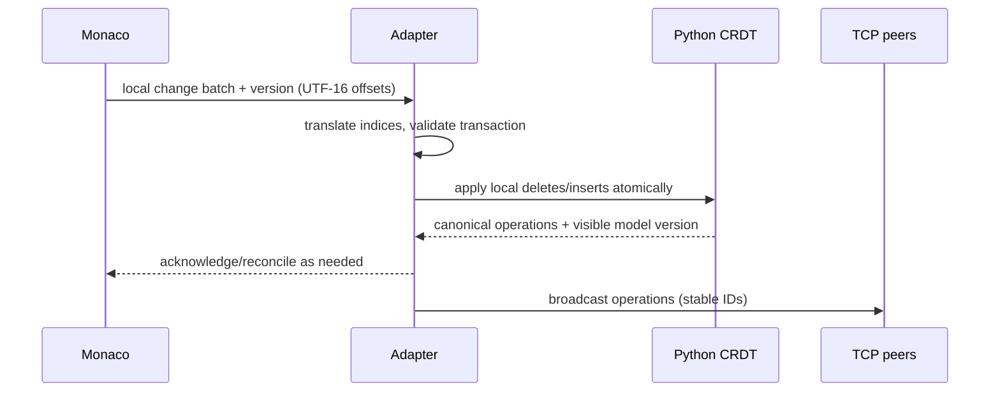
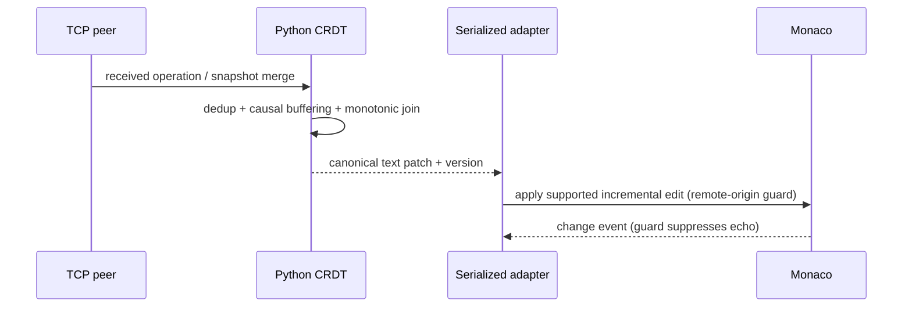

# P2PDocs 2.0 — Modernization Research

> **Historical research and attribution record.** This document reports on the
> original P2PDocs archive and deliberately retains its names, paths, and CLI
> examples as source evidence. The active repository/project is c2g — Code
> 2gether, derived from P2PDocs under the retained MIT license and Git history.

**Change request:** P2PDOCS-2.0
**Research date:** 2026-10-23
**Status:** Research proposal; NOT approved for application implementation
**Evidence basis:** Static examination of all 22 non-directory files in `P2PDocs-main(1).zip` (30 archive entries including directories). Official external documentation cited below. **No repository Python modules were executed; no network/UI tests or platform packaging builds were run.** The original ZIP has not been altered.

## 1. Executive decision brief

- **Keep:** Python CRDT/domain and network architecture, client identity per process (but define durable document identity separately), direct peer-to-peer connections, UDP LAN discovery, manual IP joining, text export, CLI.
- **Repair before UI:** character ordering, tombstone propagation, out-of-order dependencies, idempotent/full-state joins, application protocol, persistence lifecycle, and regression tests. Current `CRDTDocument` is **not proven convergent**.
- **Preferred editor (conditional):** Monaco Editor (ESM build bundled locally with Vite) hosted in a **pywebview** window. A bounded M3 proof-of-concept must verify Windows WebView2 AND Linux WebKit2/Qt WebEngine behavior, offline workers, Unicode offset conversion, selection, undo, and bridges. Use Python as document authority, not Monaco's full text buffer.
- **Preferred core fix:** correct and test the current RGA-inspired implementation first, preserving the small codebase and protocol semantics as much as possible. **Fallback:** `pycrdt` (Yrs) if convergence properties remain unachievable; this changes on-wire state and requires a migration/compatibility break.
- **Packaging:** PyInstaller **onedir** desktop builds per OS; include Monaco/Vite assets. Docker **headless** multi-peer test harness, not end-user GUI packaging.
- **Recommended Python baseline:** Python **3.12+**, subject to chosen pywebview/backend wheels and platform matrix. Python 3.13/3.14 may be in CI after compatibility checks; prefer stable support over the newest release.
- **Immediate next step:** M0 (agent setup, baseline characterization tests, metadata consistency), with no editor rewrite yet.

## 2. Evidence coverage and repository map

All named source/config files were inspected; no test files, `AGENTS.md`, `CONTEXT.md`, lockfile, Dockerfile, UI web bundle, or Graphify assets are in the archive. No executable `graphify` was found on this analysis host; that does **not** establish its availability on the developer's machine.

```text
P2PDocs-main/
├── .github/workflows/publish.yml     # tags / manual: build and PyPI publish
├── .gitignore
├── LICENSE                         # MIT
├── MANIFEST.in
├── README.md                       # ambitious claims; includes explicit limitations
├── pyproject.toml                   # PEP 621 metadata; version 1.0.14
├── setup.py                         # duplicate and conflicting metadata
└── p2pdocs/
    ├── __init__.py                  # eagerly imports UI/network/core
    ├── __main__.py                  # module startup
    ├── cli.py                       # positional username, optional peer IP
    ├── crdt/
    │   ├── document.py              # local/remote insert/delete, ordering, full state
    │   ├── message.py               # JSON message envelope
    │   └── types.py                 # CRDTId / CRDTElement
    ├── network/
    │   ├── manager.py               # TCP listen/connect/frame/send/receive
    │   └── discovery.py             # UDP announce + observed peer cache
    ├── storage/
    │   └── persistence.py           # pickle, queued background saves
    └── ui/
        ├── editor.py                # Tkinter layout, key interception, orchestration
        └── styles.py
```

### Current execution chain

`p2pdocs/cli.py:24-35` → `P2PEditor.__init__` (`ui/editor.py:21-52`) → `CRDTDocument(..., start_fresh=True)` → `NetworkManager.start_listening()` on `0.0.0.0:5000` → `PeerDiscovery.start_broadcast(5000)` and monitor → Tkinter `root.mainloop()`. The UI optionally connects to a specified peer IP. Key events (`editor.py:403-583`) mutate CRDT and broadcast `INSERT`, `DELETE`, or `BATCH_DELETE`. Received TCP frames (`network/manager.py:118-159`) enter UI `_on_network_message` (`editor.py:584-674`) and trigger whole-document Tkinter rebuilds. Disk snapshots use `PersistenceManager` (`storage/persistence.py`).



**Important nuance:** `README.md:8,110,212` calls the editor production-ready/proven, but `README.md:182-198` separately disclaims mesh and undo support. Neither reliability nor production readiness has a passing automated test suite in the ZIP.

## 3. Verified CRDT correctness problems

| ID | Finding | Evidence | Priority |
|---|---|---|---|
| CRDT-F1 | **Visual-position insertion is wrong**: successor siblings sorted by **ascending** ID; a newer insert after an existing predecessor is placed after that predecessor's older subtree rather than before the next text character. | `crdt/document.py:101-128,130-173`, `crdt/types.py:19-23` | P0 |
| CRDT-F2 | **Prepending fails** for non-empty text: old and new root siblings sorted ascending, putting newly added first-position character at the end. | `document.py:121-125,148-171` | P0 |
| CRDT-F3 | **Tombstone ancestry disappears** from rendering: the sort builds its graph from visible elements only, turning descendants of hidden nodes into new heads; can reorder surviving text. | `document.py:139,148-171` | P0 |
| CRDT-F4 | **Delete-before-insert lost:** `delete_remote()` marks an unseen ID as `applied_ops` and returns without a pending tombstone. Later `insert_remote()` inserts that ID visibly. | `document.py:175-185,210-225` | P0 |
| CRDT-F5 | **Full-state merge confuses insertion and deletion:** `apply_full_state()` records *every* incoming element ID in `applied_ops`; a later remote DELETE for a visible element is silently skipped. | `document.py:237-249,210-219` | P0 |
| CRDT-F6 | **Full-state merge is not monotonic:** for element IDs absent from `applied_ops`, assignment `self.elements[id]=elem` can overwrite a locally tombstoned element with an older `visible=True` copy. | `document.py:237-247`; contrast `delete_local` vs remote updates | P0 |
| CRDT-F7 | **Unresolved predecessor is rendered as a head** and loaded missing references are wrongly made invisible, potentially discarding legitimately delayed causal dependencies. | `document.py:66-75,148-150,175-185` | P1 |
| CRDT-F8 | `apply_full_state()` does not perform an explicit join over all stored tombstone states, and state transfer has no document/version identity or causal gap recovery. | `document.py:232-249`, `crdt/message.py` | P0 |
| CRDT-F9 | Local inserted char is not checked for single-codepoint length and IDs/remote payloads have weak type/size validation; repeated recursive DFS can become costly or hit recursion limits. | `types.py:50-84`, `document.py:101-173` | P1 |

### Reproducible code-path examples (reasoning, not runtime execution)

**A. Simple middle insertion (single replica):** type `A` (clock 1, head), then `B` (clock 2, `after=A`), then insert `X` at index 1 (clock 3, `after=A`). In `_get_sorted_visible_elements`, both `B` and `X` are successors of `A`; the ascending clock sort yields `A B X`. Requested edit was `A X B`. No network race is needed.

**B. Prepend:** begin with `A→B`, then insert `X` at index 0 (`after_id=None`, later Lamport clock). `heads.sort` places old `A` first; render becomes `A B X` rather than `X A B`.

**C. Full-state then delete:** replica B applies a full state containing a visible element `A`. `apply_full_state` stores `A`'s ID in `applied_ops`. Subsequent `DELETE(A)` calls `delete_remote` and exits immediately; `A` stays visible.

**D. Delete before insert:** B receives `DELETE(Q)` first, records dedup marker, has no element to hide. It later receives `INSERT(Q)` and creates a visible `Q`, violating the delivered deletion.

**E. Stale merge resurrects:** a replica inserts an element via `insert_remote` (which does not mark the ID applied), later deletes it via a direct visibility change in an inconsistent state or encounters a mismatched restored `applied_ops` set. An incoming state with `visible=True` overwrites the local element whenever the ID is not in `applied_ops`. The logic has no explicit `false`-wins rule. (Condition-specific vulnerability; not a claim that every local delete is resurrected.)

### Required corrected CRDT invariants

1. **Identity:** IDs globally unique across replica restarts; peer identity and *document identity* are separate.
2. **Causal reference:** every insert has a stable predecessor (or head); missing predecessors are buffered, not treated as final independent heads or deleted.
3. **Ordering:** deterministic concurrent sibling tie-breaking, with **newer local insertion at its intended visual gap**. Explore stable RGA insertion/integration order (e.g. reverse-ID sibling traversal for the existing after-only scheme), then prove under mixed histories; merely flipping a sort is not sufficient by itself.
4. **Tombstones:** hidden elements still participate in ordering. Deletion is monotonic (`visible=false` dominates `true`). Unknown deletions remain pending until their insert arrives.
5. **Merging:** idempotent and permutation-invariant; independent replicas have equal canonical order and visibility after the same causal operation set. Duplicate state or messages cannot resurrect characters.
6. **Causality:** replay, reconnect, or snapshot import cannot move Lamport counters backward or create duplicate IDs.
7. **Schema:** reject mismatched payloads, invalid identifiers, impossibly large documents/frames, and cycles/unknown references without crashing the UI.

### Option evaluation

| Dimension | Repair existing RGA-inspired engine | Replace with `pycrdt` / Yrs |
|---|---|---|
| Source control, educational demonstration | Strong | CRDT correctness delegated |
| Immediate changes to CLI/network | Contained | Requires new update framing and adapter |
| Existing JSON `INSERT`/`DELETE` protocol | Can preserve semantics with protocol version bump | Not compatible with Yrs binary updates |
| Existing pickle state | Migration required but element structure recognizable | Must convert text or one-time legacy state to Y.Text |
| Convergence confidence | Must establish through exhaustive scenarios/property tests | Uses mature CRDT implementation (integration tests still necessary) |
| Added native dependencies | None for engine | Rust-backed binary Python extension and wheels |
| Time/maintenance risk | Medium–High correctness effort | Lower algorithm risk, higher migration/packaging risk |

**Decision proposal:** First write tests reproducing F1–F8; implement a sound RGA integration algorithm with retained tombstones, pending causal operations, and safe merge semantics. Put a **timebox and hard pass/fail gate** on the CRDT. If randomized tests keep discovering irreducible design flaws, propose replacing the engine with `pycrdt`, explicitly versioning protocol and migrating local data. `pycrdt` official docs: https://y-crdt.github.io/pycrdt/ . Its published project requires Python >=3.10; platform wheel coverage requires validation.

## 4. Networking and session behavior

| ID | Evidence and implications | Recommended change |
|---|---|---|
| NET-F1 | `network/manager.py:25-35` binds **every app** to TCP `0.0.0.0:5000`; two instances on one machine conflict. `start_listening()` can return false without halting GUI. | Configurable port or OS-assigned port for test harness; surface listen status. |
| NET-F2 | UDP `discovery.py:29-56` advertises/listens, but `editor.py:280-347` only updates connected-peer UI; no connection call for discovered peers. It compares only usernames for self-filtering, and ignores advertised port in stored peer tuple. | Separate discovered and connected peers; connect action using advertised TCP port; stable peer IDs, no auto-connect until UX decision. |
| NET-F3 | No connection-establishment `SYNC_REQUEST` in `network/manager.py:40-116` or `editor.py:349-359`. A request is only broadcast in `BATCH_DELETE`'s missing-count branch (`editor.py:652-656`). | Versioned identity handshake and automatic targeted two-way state reconciliation on join/reconnect. |
| NET-F4 | `delete_remote` records even missing IDs into `applied_ops`. `BATCH_DELETE` checks `op_key in applied_ops` **after** attempting delete, making `missing_count` condition effectively unreachable for a newly missing ID. | Return structured result (`applied`, `already_deleted`, `pending_unknown`) and drive causal recovery from pending state. |
| NET-F5 | `editor.py:584-674` applies incoming operations but never forwards them to other peers; `NetworkManager.broadcast_message` sends only local/response broadcasts. | Route operations to all connected peers except origin, dedupe on stable operation ID; avoid storms. |
| NET-F6 | `manager.py:95-113` assumes every inbound peer listens on local `self.port`; TCP handshake reads usernames using single `recv(1024)` with no framed or versioned hello, and connections identify by IP:port. | Framed HELLO `peer_id`, `doc_id`, `listen_port`, `protocol_version`, limits; resolve simultaneous duplicate connections deterministically. |
| NET-F7 | `_recv_buffers[peer_id]` is shared mutable dictionary; peers can be removed during/after callback; malicious peers can hold partial frames; length cap 10MB helps but no global per-peer time/buffer controls. | Bounded frame + buffering, timeouts, per-peer state and careful locks; isolate listener errors. |
| NET-F8 | `SYNC_REQUEST` replies via broadcast to **all** peers (`editor.py:660-664`); no correlation or targeted reply. | Targeted replies and session/round IDs or simple deterministic anti-entropy protocol. |
| NET-F9 | Plaintext unauthenticated TCP listening on all interfaces; LAN broadcasts disclose usernames, and malicious peers could inject expensive/malformed state. | Treat current feature as trusted-LAN only; document risk, validate size/schema, add explicit trust/allow action. Encryption/auth are a separate scope decision. |
| NET-F10 | `_periodic_sync()` computes an MD5 hash then discards it (`editor.py:739-751`); it does not synchronize replicas. | Remove unused hash or implement bounded periodic divergence/reconciliation check after core correctness. |

**Recommended minimal session scope:** truthful two-peer and connected three-peer reconciliation, not WAN NAT traversal, relay hosting, account management or discovery beyond LAN. New peers join by selected `doc_id` with version-compatible handshake, request full state plus required tombstones, merge, then transmit deltas. For disconnections, exchange a checkpoint/state hash and reconcile on reconnection. Define ownership of an empty document and what happens when two peers have unrelated documents before choosing union vs join.



## 5. Monaco architecture comparison

| Criterion | Monaco + pywebview (A) | Monaco + Qt WebEngine (B) | Electron/Tauri + Python process (C) | Enhanced Tk/native editor (D) |
|---|---|---|---|---|
| VS Code editor fidelity | **Excellent — real Monaco** | Excellent | Excellent | Low–Medium |
| Keeps Python core | Yes, direct JS bridge | Yes, Qt bridge | Yes, IPC required | Yes |
| Complexity | **Medium** | Medium–High | High | Low initially, high to match features |
| Windows | WebView2 runtime needed | Qt WebEngine bundled | Larger shell | Tk available |
| Linux | GTK/WebKit2 or Qt backend and system libs | Qt WebEngine / platform plugins | OS runtime / bundling overhead | Tk system libs |
| Offline | Yes with local assets served over safe localhost | Yes with scheme/worker support validated | Yes | Yes |
| Cross-boundary behavior | Promise-based JS↔Python bridge; thread scheduling to validate | QWebChannel, more Qt plumbing | IPC and subprocess lifecycle | No bridge |
| Release size | Low to medium plus system renderer | Medium to high | Often largest (Electron), Tauri smaller but additional stack | Smallest |
| Maintenance | **Moderate**; mixed Python/JS toolchains | More Qt-specific runtime issues | Two process/app frameworks | Customized editor feature burden |
| License | Monaco MIT; third-party notices | Monaco MIT; Qt runtime licensing must be reviewed | Monaco MIT; Electron/Tauri licenses and notices | Tk/Tcl license |
| Key risk | Monaco worker loading, Linux renderer, undo and events | Qt packaging and renderer/tooling | IPC/runtime/large rewrite | Cannot deliver genuine VS Code editing |

**Provisional recommendation:** A, with a fail-fast M3 spike. If Linux pywebview/Monaco proves unreliable, choose B (Qt WebEngine) **without rewriting the Python document/core interface**. C is unjustified for a focused desktop editor; D cannot deliver the requested actual Monaco UI.

### Editor-to-CRDT contract (proposed)

**Authoritative state:** Python `CRDTDocument` after every committed accepted transaction. Monaco displays a projection and emits **text-change transactions**, not authoritative full-document snapshots.

- **Bootstrap:** Python builds/reconciles document first, then initializes Monaco model once using a stable document URI, language, `vs-dark` theme and locally bundled assets. Normal editing starts after bridge ready/ACK.
- **Local changes:** `onDidChangeModelContent` emits `{document_id, local_txn_id, model_version, changes:[{rangeOffset,rangeLength,text}], selection}`. The changes represent Monaco UTF-16 offsets and can be multi-change; process atomically, in model-version order. Validate/sort against a *pre-change* snapshot (normally descending offsets when translating to a mutable sequence). Convert positions to Python element indices; do not assume JS and Python Unicode indexing match. Generate deletes and inserts as one logical transaction and broadcast stable operations.
- **Remote changes:** Python core integrates operations in a serialized dispatcher; computes a minimal text edit patch/diff against last published document projection; calls Monaco `executeEdits`/supported model edit APIs in a guarded *remote-origin* transaction (not `setValue` on every keystroke). Editor changes still produce events; use an origin/transaction guard to avoid echo.
- **Selection and undo:** Preserve Monaco view state/selections and transform anchor positions through each patch. Undo/redo of a collaborative edit must produce new inverse CRDT operations tied to prior local intent, not simply revert full-string state. **Undo is a high-risk feature with independent acceptance tests.** Do not claim it complete because Monaco exposes Ctrl+Z.
- **Concurrency:** The Python UI↔CRDT adapter must serialize local edits and network deliveries, reconcile document/model version mismatches, and never call GUI operations directly on arbitrary socket threads. Use a queue and explicit acknowledgment or version reconciliation. Avoid holding CRDT locks while waiting on JS bridge or blocking network sends.
- **Unicode:** Monaco offsets are UTF-16 code units; Python indexing is Unicode code points. An emoji like `😀` is 2 UTF-16 units but 1 Python code point. Create tested offset mapping both ways and define treatment of surrogate/combining sequences, CRLF normalization, IME composition, and multi-cursor edits.
- **Asset serving:** Official Monaco README warns `file://` does not support workers. Bundle **ESM** Monaco via Vite (AMD build is deprecated) and serve assets using pywebview's built-in local server or a bound `127.0.0.1` ephemeral-port static server with no remote access, no CDN dependence, CSP as practical. Ship source-license notices. See https://github.com/microsoft/monaco-editor and https://pywebview.flowrl.com/api/ .

### M3 spike go/no-go list

1. Monaco ESM starts **offline** from packaged local assets with functioning workers and syntax highlighting in both Linux target renderer and Windows WebView2.
2. 100 one-character edits and a 10,000-character paste result in a byte-for-byte equal Python document and Monaco model (Unicode/CRLF normalization documented).
3. A remote insertion/deletion updates Monaco incrementally without echo/rebroadcast loop or losing selection.
4. Ctrl+Z / Ctrl+Y after interleaved remote operations either work per defined semantics or are explicitly disabled behind a labeled limitation until implemented.
5. Graceful startup/shutdown, resize, focus/clipboard, search and line numbers. No accidental remote HTTP listener.
6. Packaging feasibility: locate resources in frozen executable, examine native webview dependencies; record artifact footprint before commitment.

## 6. Persistence and file lifecycle

- `ui/editor.py:23-25` unconditionally passes `start_fresh=True`, and `crdt/document.py:26-31` explicitly calls `PersistenceManager.clear()`. README recovery promise is not active in GUI startup.
- All users of the app share `doc_name="collaborative_doc"`, storing `~/.p2p_crdt/.collaborative_doc_state.pkl` (`persistence.py:20-23`); multiple local processes can overwrite the same file. There's no document ID binding in the saved state.
- `PersistenceManager.load_state` uses **`pickle.load`** (`persistence.py:76-84`): reading tampered/untrusted pickle is unsafe. Never migrate by loading arbitrary saved files from a peer; any legacy conversion should be explicitly user-triggered and tightly isolated, if supported at all.
- Writes use `open(...,'wb')` and `pickle.dump` without atomic temp-write + fsync + replace (`persistence.py:45-52`). Crashes can leave truncated files.
- Asynchronous writer stores mutable `applied_ops` set reference in queued state (`persistence.py:54-62`); `_persist_state()` runs under CRDT lock but file I/O is async, so snapshot consistency isn't guaranteed. Worker/flush can overlap without join (`persistence.py:31-44,94-108`); no completion acknowledgement.
- State reload with missing predecessors **marks elements tombstoned** (`crdt/document.py:66-75`) rather than retaining pending causal state.

**Proposed repair:** stable doc IDs, explicit New/Open/Resume choices (default resume last doc if healthy, safe recovery UX), sanitized per-document paths (via `platformdirs` if justified or `pathlib` standard directories), versioned JSON/MessagePack-equivalent structured state with schemas and file-size caps (standard JSON + atomic write is enough for MVP). Persist whole state including tombstones, pending operations and clocks; immutable snapshot before queueing; single writer with flush/join and atomic replacement, recovery backup, corruption handling. For existing pickle files, do not auto-open; document a one-time, trusted, opt-in migration and preserve originals.

## 7. Dependencies / metadata and CI audit

**Current external runtime dependencies: zero declared.** Source imports standard Python library, including `tkinter` (normally separate OS package on some Linux installs). The modern UI adds dependencies, but the present app does **not** contain deprecated third-party runtime packages.

| Component | Existing evidence | Issue | Recommendation | Priority |
|---|---|---|---|---|
| Python version | `pyproject.toml:10,24-28`, `setup.py:42` require >=3.7 | Python 3.7 EOL; Python 3.10 EOL as of 2026-10-01; classifiers stop at 3.11 | Base target 3.12+ pending wheel/platform test matrix; CI verify 3.12, 3.13, optionally 3.14 | P1 |
| Packaging metadata | `pyproject.toml:5-39` and `setup.py:16-54` duplicate most fields | Conflicting author and bad setup.py Source URL typo (`P2PDocss`) | Single `[project]` source in pyproject; remove legacy duplicate or leave minimal `setup()` only if necessary | P1 |
| License metadata | `pyproject.toml:11` `license={text="MIT"}` | Legacy table is deprecated by PEP 639 | Use SPDX `license="MIT"` with compatible modern setuptools; reconcile classifiers | P1 |
| Build requirements | `pyproject.toml:1-3` setuptools>=45, wheel, setuptools_scm>=6.2 | Loose old floor; SCM included with static version; unnecessary complexity | Modern setuptools baseline supporting PEP 621/639; drop setuptools_scm if no dynamic version strategy | P1 |
| Dependency lock | None | New Python + JS stacks need reproducibility | Lock npm via package-lock, Python tool dev dependencies via suitable lockfile once stack chosen; separate runtime from dev | P1 |
| Test automation | No tests/pytest config | No correctness evidence | `pytest`, optionally `hypothesis`, `ruff`; small test suite first; avoid excessive tooling | P0 |
| CI | `.github/workflows/publish.yml:18-23` checkout@v4, setup-python@v4 | Build/publish workflow lacks test gate and uses older action | Refresh to maintained supported actions and pin trusted releases or commit SHAs | P1 |
| Release | `publish.yml:39-59` publishes on `v*` or manual dispatch with OIDC | Publish can occur without correctness/build matrix | Gate release on tests + desktop artifact checks, separate PyPI from desktop release if retaining PyPI | P1 |
| Versioning | `__init__.py`, `setup.py`, `pyproject.toml` all specify 1.0.14 | Multiple sources of version truth | One canonical version source; dynamic importlib.metadata at runtime if appropriate | P2 |
| Tk import | `p2pdocs/__init__.py` eagerly imports `P2PEditor` | Headless import of `p2pdocs.crdt` may import UI/Tk; complicates CI and Docker | Lazy UI import and clean core-only import path | P1 |
| Modern Monaco | Not present | Adds frontend build and runtime assets | Pin `monaco-editor` and Vite with npm lock; bundle output, not node_modules | P1 |

Official evidence: https://packaging.python.org/en/latest/guides/writing-pyproject-toml/ ; https://setuptools.pypa.io/en/latest/userguide/pyproject_config.html ; https://devguide.python.org/versions/ ; https://docs.github.com/en/actions/tutorials/build-and-test-code/python . Verify specific version compatibility during M3/M6, not from assumptions.

## 8. Desktop packaging versus Docker

| Concern | PyInstaller | Nuitka | Docker |
|---|---|---|---|
| End-user desktop experience | **Best initial option**: native app folder and shortcut/installers optional | Good alternative; compiler overhead | Poor: requires daemon/GUI display permissions |
| Python needed on target | Bundled | Bundled | Runtime inside container, but Docker itself needed |
| Windows/Linux builds | Per-OS runners, **not** cross-compilation | Per-OS toolchains | Multi-platform container images but GUI platform mismatch |
| Monaco assets | Bundle Vite `dist` as datas and resolve frozen paths | Same requirement | Could serve as files/HTTP in container; extra browser display integration |
| Webview native dependencies | WebView2 on Windows, GTK/WebKit2 or Qt libraries on Linux still need checks | Same | GUI backend must connect to host display |
| Network simulation | Doesn't help | Doesn't help | **Excellent** for headless three-peer TCP fault and reconnection tests |
| LAN UDP discovery | Native host networking | Native host networking | Docker NAT and broadcast vary; test only on real LAN/host net |
| Operational complexity | Moderate | Higher build complexity | High for desktop; modest for isolated tests |

**Packaging recommendation:** PyInstaller `onedir` per OS in M6; **Windows** needs documented WebView2 runtime/install behavior; **Linux** needs system WebKit2 or Qt WebEngine platform libraries, likely distro-specific packaging. Start with a zipped desktop app build, do installers later. Use Docker Compose only for **headless** peer simulation with explicitly mapped/configurable TCP ports; in-container UDP broadcasts should not be used as proof of physical LAN discovery. `network_mode: host` constraints and cross-platform behavior must be recorded (Docker Docs: https://docs.docker.com/engine/network/drivers/host/). PyInstaller docs: https://pyinstaller.org/ . Nuitka: https://nuitka.net/ .

## 9. Verification/acceptance strategy

**Critical order:** RED tests for known bugs → correctness fix → network join/reconnect verification → Monaco spike → UI replacement → persistence/build/release.

### CRDT tests (run headlessly)

- `test_insert_at_start_middle_end`: `AB` + index 1 `X` must be `AXB`, index 0 `Y` must be `YAXB`.
- `test_tombstone_preserves_successor_positions`: descendants of tombstoned parent retain stable order among siblings.
- `test_delete_before_insert`: delete stays pending and hides later insert; duplicate operations harmless.
- `test_full_sync_then_delete`: post-merge delete changes visible text.
- `test_no_resurrection`: stale `visible=True` snapshot never overrides local `False`.
- `test_concurrent_insert_permutation`: random delivery orders yield identical text and structural tombstone state.
- `test_three_replicas_join_rejoin`: relay, reconnect, duplicate/drop/reorder + final reconciliation converge.
- `test_stable_id_resume`: IDs after reload don't collide or regress.
- `test_large_chain`: deep sequence doesn't overflow recursion / degrade catastrophically for target scale.
- `test_unicode`: emoji, combining marks, newlines, CRLF normalized as specified.

**Suggested tools:** pytest, hypothesis for generated histories, Python socket fixtures on loopback with per-test ports; Playwright or equivalent for Monaco frontend interaction where embedded webview automation is difficult, plus smoke checks in actual desktop shell. Tests should assert both *text* and normalized internal CRDT state after quiescent delivery. A test passing without replay duplicates is not sufficient. Track a regression test reference per bug ID.

### Network tests

- Framing: split prefix/body, coalesced frames, 0/negative-equivalent oversize, invalid UTF-8/JSON, high watermark, abrupt close.
- Handshake: valid/invalid protocol versions, distinct docs, duplicate simultaneous connections, ephemeral listen ports, trusted peer UX.
- Operational: join a nonempty document, remote insert/delete, reconnect after missed ops, A↔B↔C relay exactly once, chain/partial mesh convergence.
- Fault model: deliveries may be duplicated/out of order in test harness even if TCP orders bytes *per connection*; reconnections and multiple paths introduce reordering.

### UI tests

- Local typing/multicursor/paste/replace, Backspace and Delete, Ctrl+Z/Y under local/remote concurrency, offset boundaries around `😀` and composed characters, remote patch no feedback, view state preservation.
- Post-edit invariant: eventually Monaco model text === CRDT visible text for every participant, and selection indices remain valid.
- Offline startup with static assets and worker initialization; no network requests to CDN or external services.

### Runtime verification status

**Not run in this research stage:** pytest (none present), executable GUI, TCP/UDP tests, Monaco, pywebview, native packaging, Docker. The examples above are source-grounded logical reproductions, not observed test output. Graphify CLI unavailable on analysis host; no graph index was created.

## 10. Proposed target architecture and diagrams







**Thread/process boundaries:** One desktop process unless spike proves otherwise. Python main GUI event loop must own native window operations. TCP receive threads only enqueue validated events; single CRDT event dispatcher applies changes sequentially and emits document-change notices. pywebview JS bridge calls arrive asynchronously; never mutate shared model outside dispatcher. Persistence uses an independent single-writer thread and immutable snapshots. All interactions with webview APIs follow their documented thread rules, proven in spike. No separate HTTP network service besides optional loopback-only static asset server.

**Proposed (subject to spike) repo additions:**

```text
p2pdocs/
  crdt/                 # repaired core + invariants
  network/              # transport, framed hello and sync session
  storage/              # versioned atomic state
  ui/                   # webview host, adapter, bridge
  cli.py
web/                   # small Vite + Monaco frontend
  package.json
  package-lock.json
  src/
  index.html
  dist/                 # generated for packaging, not authoritative source
scripts/                # optional reproducible build tools
Dockerfile.tests        # headless tests only (M6)
compose.test.yml
 tests/                  # unit, network, adapter, UI smoke
 docs/                  # research / change request / milestones
```

## 11. Existing-feature preservation map

| Existing behavior | Action | Rationale |
|---|---|---|
| Peer-to-peer without central server | Preserve with fixes | Fundamental product value |
| Manual IP connection | Preserve with handshake/port support | Basic reliable fallback |
| UDP discovery | Preserve announcements, expose connect action | Current discovery does not auto-connect; avoid unsafe silent joining |
| Connected peer sidebar | Replace with equivalent Monaco shell controls | UI redesign only |
| Text export via Save | Preserve | `editor.py:370-400` writes UTF-8 text |
| Persistent CRDT state | Correct and version | Current startup clears it; pickle unsafe |
| CLI `p2pdocs username [ip]` | Preserve; optional port flag | Compatibility |
| TCP JSON operations | Preserve when possible, version handshake | Fixes require protocol semantics changes |
| Offline editing | Preserve and verify | Entire editor should load offline |
| Document identity / join behavior | Add minimally | Required to prevent merging unrelated sessions |
| Undo/redo | **Not reliable today**; new scoped implementation | Tk widget `undo=True` is not collaborative undo correctness |
| Multi-peer relay | Add limited supported topology | README currently disclaims full mesh |

## 12. Known risks, tradeoffs, and unanswered questions

1. **Highest risk:** Designing a correct text CRDT is not simply a sorting change. Success requires strong randomized convergence tests and a fallback decision.
2. **Bridge risk:** UI event order, multi-edit patches, IME and Unicode mapping can desynchronize Monaco and Python even with a correct CRDT.
3. **Linux renderer risk:** WebKit2/GTK version or Qt libraries may vary; the Linux spike needs a documented target distro.
4. **Undo risk:** Monaco's local history does not automatically implement collaborative undo. Accept only explicit semantics and tests.
5. **Persistence risk:** Existing pickle files are unsafe to deserialize from untrusted origin, and state format will change. Decide if trusted opt-in migration is worth it.
6. **Compatibility risk:** New protocol should reject incompatible peers explicitly rather than silently merging incompatible state.
7. **Security risk:** Trusted-LAN-only, unauthenticated networking must be honestly labeled; do not market as safe for the open internet.
8. **Distribution scope:** Decide whether first release targets both Windows + Ubuntu/Linux; macOS is out of the initial scope unless specifically requested.
9. **Document behavior:** On manual connect, choose between “join remote document” and “merge my existing local document”; do not silently merge unrelated documents.
10. **Scale:** Define practical maximum document size and peer count; no benchmarks in archive establish throughput/latency.

## 13. Research sources (public documentation)

Checked on 2026-10-23; these URLs are external research, not facts found in this repo:

- Microsoft Monaco editor, ESM and worker constraints: https://github.com/microsoft/monaco-editor
- Monaco changelog (AMD deprecation): https://github.com/microsoft/monaco-editor/blob/main/CHANGELOG.md
- pywebview API & JS bridge: https://pywebview.flowrl.com/api/ and https://pywebview.idepy.com/en/guide/interdomain
- pywebview native dependencies: https://pywebview.flowrl.com/guide/installation and https://pywebview.flowrl.com/guide/web_engine
- PyInstaller manual: https://pyinstaller.org/
- Python support periods: https://devguide.python.org/versions/
- Python packaging and SPDX license: https://packaging.python.org/en/latest/guides/writing-pyproject-toml/
- Setuptools PEP 621: https://setuptools.pypa.io/en/latest/userguide/pyproject_config.html
- Docker host-network limitations: https://docs.docker.com/engine/network/drivers/host/
- Graphify Codex integration: https://www.graphiffy.com/integrations/codex and https://graphiffy.com/docs/cli
- Python CRDT fallback: https://y-crdt.github.io/pycrdt/
- GitHub Python workflows / trusted publishing: https://docs.github.com/en/actions/tutorials/build-and-test-code/python

**Research finding vs inference:** Path/line statements above are repository observations; integration approach, milestone ordering, and performance expectations are recommendations; runtime compatibility and convergence remain unverified pending tests and platform spikes.
